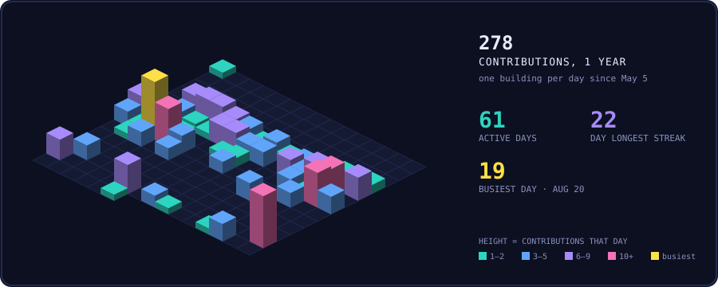

  

  <a href="https://harshdeep-portfolio-tau.vercel.app"><b>Portfolio</b></a> &nbsp;·&nbsp;
  <a href="https://www.linkedin.com/in/harshdeep-singh-073b02320/"><b>LinkedIn</b></a> &nbsp;·&nbsp;
  <a href="https://harshdeep-portfolio-tau.vercel.app/Harshdeep_Singh_Resume.pdf"><b>Résumé</b></a>

 

## Now

- Technical intern at **Neubitat** — production Next.js sites, a React Native (Expo) app, and an AI-assisted content pipeline built on Claude.
- Previously the sole engineer on the **AI voice agent at Zeber** (speech recognition, LLM tool planning and speech synthesis as separate FastAPI services).
- Won **1st place at the TCS AI Hackathon 2026** (1st of ~130) with a team of five — [EcoSort](https://github.com/harshdeepsingh888-ps/EcoSort).
- Open to SWE internships.

  

## Selected work

| Project | What it does | Stack |
| :-- | :-- | :-- |
| [**Devforge**](https://github.com/harshdeepsingh888-ps/Devforge) | Developer operating system — work items, ADRs, commits and deploys in one model. | Fastify · Prisma · PostgreSQL · React |
| [**GatePulse**](https://github.com/harshdeepsingh888-ps/GatePulse) | API gateway dashboard — API keys, token-bucket rate limiting, traffic analytics. | Express · Prisma · PostgreSQL · Docker |
| [**SyncRoom**](https://github.com/harshdeepsingh888-ps/syncroom) | Watch party where the server owns playback, so everyone stays in lockstep. | React 19 · Express 5 · Socket.IO |
| [**AI Voice Agent**](https://github.com/harshdeepsingh888-ps/AI_VOICE_AGENT) | Speak a request, it acts on it — Whisper, Gemini tool planning, Edge TTS. | Python · FastAPI · Gemini |
| [**Officer Prep**](https://github.com/harshdeepsingh888-ps/officer-prep) | Installable study app for India’s officer exams; tests gate every deploy. | React · IndexedDB · Playwright |
| [**DSA Metro**](https://github.com/harshdeepsingh888-ps/dsa-metro) | Data structures taught as a metro map, Big-O to dynamic programming. | Next.js · TypeScript |

Also: browser games on three.js — [Rutwater](https://github.com/harshdeepsingh888-ps/rutwater) and [Needle Run](https://github.com/harshdeepsingh888-ps/needle-run).

## Stack

**Languages** TypeScript · Python · JavaScript · Dart  
**Backend** Node.js · Express · Fastify · FastAPI · Prisma · PostgreSQL · MongoDB · Socket.IO  
**Frontend** React · Next.js · React Native  
**Tooling** Docker · GitHub Actions · Vitest · Playwright · Terraform

 

Everything above links to a public repository. Details and case studies are on the <a href="https://harshdeep-portfolio-tau.vercel.app">portfolio</a>.

